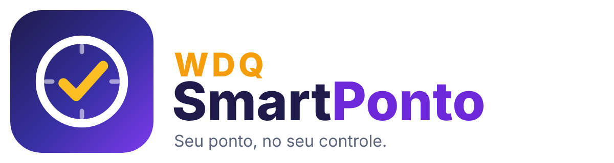

<p align="center"></p>

# WDQ SmartPonto

Controle pessoal de ponto para **Android e iPhone**. Abra, toque em **Entrada**, **Intervalo**, **Retorno** ou **Saída**, e o app registra o horário. Gera relatórios por dia, semana, mês, ano ou qualquer período.

Os dados ficam só no aparelho, sem conta e sem servidor, e o app funciona sem internet.

## Como instalar

| Aparelho | Como |
| --- | --- |
| **Android** | Baixe https://weberdequeiroz.github.io/WDQ-SmartPonto/SmartPonto.apk e instale (permita "instalar apps desconhecidos"). Também fica na [última Release](../../releases/latest). |
| **iPhone** | Abra o endereço do GitHub Pages no **Safari** → **Compartilhar** → **Adicionar à Tela de Início**. O app abre em tela cheia, como um app nativo. |
| **Android sem APK** | Abra o mesmo endereço no Chrome → menu → **Instalar app**. |

> A Apple não permite instalar APK nem apps fora da App Store sem conta de desenvolvedor paga. Por isso o iPhone usa a versão web instalável (PWA), com as mesmas telas e funções.

Para publicar o endereço do iPhone: no GitHub, **Settings → Pages → Source: GitHub Actions**, e rode o workflow **Publicar SmartPonto** (ele também roda sozinho a cada mudança em `web/`). O endereço fica em `https://<usuário>.github.io/<repositório>/`. Em repositório privado, o GitHub Pages exige um plano pago.

## Funções

| Tela | O que tem |
| --- | --- |
| **Ponto** | Relógio, situação atual (trabalhando, em refeição, em pausa, fora), botão principal com a próxima marcação, botão direto de **Refeição** e de **Pausa** (café, descanso, a serviço, treinamento, médico, pessoal, outro; as pausas pagas contam como trabalho), modalidade da entrada (presencial, home office, externo, viagem), horas do dia, saída prevista, progresso da jornada, banco de horas e marcações de hoje. Botão **Desfazer** logo após marcar. |
| **Histórico** | Mês a mês, cada dia com seus horários e saldo. Toque no dia para corrigir, incluir marcação esquecida ou lançar **folga, feriado, férias, atestado, abono ou falta**. |
| **Lembretes** | Crie lembretes do dia a dia de trabalho com **alarme em tela cheia** (som contínuo, aparece na tela bloqueada, botões Concluir e Adiar 5/10/30 min) ou **notificação**. Repetição: uma vez, todo dia, dias da semana, a cada N dias/semanas/meses, de tempo em tempo no dia (ex.: a cada 1h das 9h às 18h), dia fixo do mês (com opção de antecipar ou adiar se cair em fim de semana ou feriado), N-ésimo dia útil do mês (1º, 5º, último…), N-ésimo dia da semana do mês (ex.: 2ª segunda, última sexta) e todo ano. Opções: só em dias úteis, só nos dias da jornada, aviso antecipado e data final. Mostra as próximas datas antes de salvar e exporta para a agenda (.ics). |
| **Relatórios** | Dia, semana, mês, ano ou período livre: trabalhado, previsto, saldo, horas extras, débito, média por dia, faltas e abonos, gráfico e tabela. Exporta **PDF** (espelho de ponto com campos de assinatura), **planilha CSV** (Excel / Google Planilhas) e **resumo em texto**. |
| **Ajustes** | Nome, empresa, cargo e matrícula; horário de trabalho por relógio (todo dia igual, por dia da semana ou escala 6x1, 12x36, 24x48…), com modelos prontos e seus próprios modelos; tolerância diária (padrão de 10 min, CLT art. 58 §1º); saldo inicial do banco de horas; confirmação antes de marcar; localização opcional; tema claro/escuro; backup. |

Também alerta sobre saída não registrada, intervalo menor que 1h em jornada acima de 6h e mais de 10h trabalhadas no dia. Turnos noturnos que passam da meia-noite contam no dia da entrada.

## Meu horário de trabalho

Em **Ajustes → Meu horário de trabalho**, só horários de relógio; o app calcula as horas do dia e da semana.

- **Dias fixos:** toque nos dias em que trabalha e informe entrada, saída, saída e volta do almoço. Em *Algum dia tem horário diferente?* ajuste um dia específico (ex.: sábado até 12:00).
- **Escala:** toque no tipo (6x1, 5x1, 4x2, 12x36, 24x48) e informe **o seu último dia de folga** — o app monta a sequência. *Outra* permite montar uma sequência personalizada.
- Um **calendário dos próximos 14 dias** mostra trabalho e folga para conferir. Configurações antigas são convertidas automaticamente.

## Esqueceu de marcar? Preencher e corrigir pela jornada

Os horários vêm de **Meu horário de trabalho**.

- **Preencher um dia:** no Histórico, toque no dia e em **Preencher com a jornada**. Os horários aparecem para conferir e ajustar antes de confirmar.
- **Corrigir um dia lançado errado:** no dia, **Corrigir pela jornada** → **Refazer o dia** (substitui tudo) ou **Completar o que falta** (mantém o que foi marcado e acrescenta só o que faltou, como a saída).
- **Selecionar dias:** no Histórico, toque em **Selecionar dias**, marque os dias que quiser (ou use os atalhos *Dias em branco* e *Todos os dias de trabalho*) e toque em **Preencher pela jornada**. Dias vazios são preenchidos; dias com marcações podem ser refeitos ou completados.
- **Vários dias de uma vez:** a tela inicial avisa quando há dias de trabalho sem marcação, e o Histórico mostra **Preencher N dias sem marcação**. Para cada dia dá para escolher preencher, lançar folga, falta, férias, atestado, feriado, abono ou deixar em branco.
- **Hoje:** se o dia começou e nada foi marcado, aparece **Esqueceu de marcar? Preencher até agora**.

Tudo pode ser desfeito logo depois, e as marcações ficam identificadas como **preenchidas pela jornada** no histórico, na planilha e com asterisco no espelho de ponto.

## Alertas do ponto

Opcionais, em Ajustes: lembrar de marcar a entrada, fim do intervalo de refeição, 15 min antes de completar 6h sem intervalo, jornada cumprida e esqueceu de marcar a saída. O app também avisa quando o descanso entre jornadas fica abaixo de 11h.

## Alarmes no Android e no iPhone

- **Android (APK):** os avisos tocam com o app fechado, na tela bloqueada e depois de reiniciar o celular. Na tela Lembretes, o app mostra quais permissões faltam (notificações, alarme exato, tela cheia, economia de bateria) com um botão para cada uma.
- **iPhone / navegador:** o iOS pausa apps instalados pelo Safari quando saem da tela, então os avisos só tocam com o app aberto. Para avisar com o celular bloqueado: **Ajustes → Alertas do ponto → Adicionar alertas do ponto à Agenda** (entrada, almoço, volta e saída, repetindo pelo seu horário ou escala) e, nos lembretes, **Adicionar à agenda**.

## Servidor de avisos (iPhone com o app fechado)

A pasta `server/` tem um servidor pequeno em PHP (Hostinger ou similar) que envia notificações ao iPhone na hora dos lembretes e alertas do ponto, mesmo com o app fechado. Guia: [server/LEIA-ME.md](server/LEIA-ME.md).

## Backup

- **Fazer backup e enviar**: gera um arquivo `.json` e abre o compartilhamento (Google Drive, iCloud, e-mail, WhatsApp).
- **Salvar backup no aparelho**: no Android, salva em `Downloads/SmartPonto`.
- **Restaurar**: junta com os dados atuais ou substitui tudo.
- O app lembra de fazer backup a cada 7 dias (ajustável). No Android, os dados também entram no backup automático do Google.

## Identidade visual

Relógio com um visto dourado, sobre gradiente índigo e violeta. Os arquivos estão em `web/icons/` (`icon.svg`, `maskable.svg`, `wordmark.svg` e os PNGs). O app é independente e não tem vínculo com nenhuma empresa.

## Estrutura

```
WDQ-SmartPonto/
├── web/          App (HTML, CSS, JavaScript puro): usado no iPhone, no navegador e dentro do APK
│   ├── js/calc.js      cálculos de jornada, saldo e relatórios
│   ├── js/store.js     armazenamento local (IndexedDB) e backup
│   ├── js/platform.js  compartilhar, salvar, imprimir (navegador ou ponte Android)
│   └── js/app.js       telas
├── app/          APK: WebView que carrega web/ e oferece compartilhamento, Downloads e PDF
└── tests/        testes dos cálculos (node --test tests/*.mjs)
```

A cada push no `main`, o workflow **Build e Release** testa, gera o APK e publica uma Release. Para testar a versão web localmente: `cd web && python3 -m http.server`, e abra `http://localhost:8000`.

**Aviso:** este app serve para controle pessoal e não substitui o registro de ponto oficial do empregador (Portaria MTP 671/2021).
